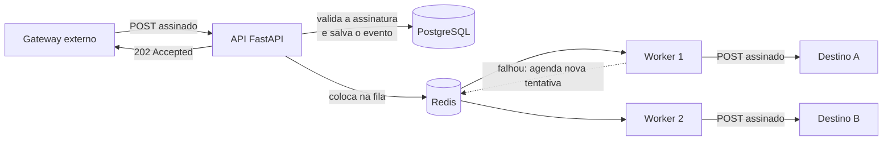

<h1 align="center">webhook-relay</h1>

<p align="center">
  Recebe avisos de serviços externos, confere se são verdadeiros e garante que cheguem ao destino, mesmo que ele esteja fora do ar.
</p>

<p align="center">
  
  
  
  
  
  
</p>

---

## Por que eu fiz isso

Quando alguém paga um Pix numa loja online, quem avisa a loja que o pagamento caiu é um **webhook**: o banco ou o gateway faz um `POST` numa URL da loja. Parece simples, mas estudando o assunto encontrei três jeitos de isso dar errado:

- **Alguém finge ser o gateway.** Qualquer pessoa pode mandar um `POST` para a sua URL dizendo "pedido 42 pago".
- **O seu servidor está fora do ar** justamente na hora em que o aviso chega, e o evento se perde.
- **O gateway manda o mesmo aviso duas vezes**, porque não recebeu resposta a tempo.

Então montei um serviço que fica no meio do caminho. Ele valida, guarda, responde rápido e assume a responsabilidade de entregar, tentando de novo até conseguir.

## Como funciona



## As partes de que mais me orgulho

**Assinatura que não dá para reaproveitar.** Toda requisição precisa do cabeçalho `X-Signature: t=<timestamp>,v1=<hmac>`, no mesmo estilo dos grandes gateways de pagamento. O horário faz parte do que é assinado. Se alguém capturar uma requisição verdadeira e tentar reenviá-la 10 minutos depois, ela é recusada. Se mudar o horário, a assinatura quebra. A comparação usa `hmac.compare_digest`, que leva o mesmo tempo acertando ou errando, então não dá para descobrir a assinatura pelo tempo de resposta.

**Responder rápido e trabalhar depois.** A API só valida, salva e coloca na fila, e responde `202` em milissegundos. Quem faz a entrega são os workers. Dá para subir quantos quiser (o Docker Compose já sobe 2), e cada entrega é pega por um só.

**Tentar de novo do jeito certo.** Se o destino falhar, o tempo de espera dobra a cada tentativa (até 1 hora) e é sorteado dentro desse limite. O sorteio parece detalhe, mas evita que um servidor que acabou de voltar receba centenas de entregas atrasadas no mesmo segundo e caia de novo.

**Saber a hora de desistir.** Erro de rede, 5xx, 408 e 429 valem nova tentativa. Outros 4xx, como 400 ou 404, vão direto para a fila morta, porque repetir a mesma requisição não vai mudar a resposta.

**Fila morta com reenvio manual.** Depois de 8 tentativas, a entrega fica marcada como `dead`, com o último erro guardado. `GET /deliveries` mostra essas entregas e `POST /deliveries/{id}/retry` as coloca de volta na fila, para quando o problema do outro lado for resolvido.

**Sem entrega duplicada.** Se o gateway mandar `X-Event-Id`, um evento repetido é reconhecido pelo banco (`UNIQUE (source_id, external_id)`) e não é entregue de novo.

## Rotas

| Método | Rota | O que faz |
|---|---|---|
| `POST` | `/sources` | Cadastra uma origem e mostra o segredo dela (só nessa hora) |
| `POST` | `/destinations` | Cadastra um destino e mostra o segredo dele (só nessa hora) |
| `PATCH` | `/destinations/{id}` | Ativa ou pausa um destino |
| `POST` | `/webhooks/{origem}` | Recebe um webhook assinado |
| `GET` | `/events` | Lista os eventos recebidos (paginado, com filtro por origem) |
| `GET` | `/events/{id}` | Mostra um evento e como está cada entrega |
| `GET` | `/deliveries?status=dead` | Mostra a fila morta |
| `POST` | `/deliveries/{id}/retry` | Reenvia uma entrega morta |

## Rodando na sua máquina

```bash
docker compose up --build
```

Isso sobe a API (porta 8000), 2 workers, PostgreSQL, Redis e um **receptor de exemplo** (porta 9000) que falha em 30% das vezes de propósito, para dar para ver as novas tentativas acontecendo nos logs.

**Teste de ponta a ponta:**

```bash
# 1. cadastra a origem e anota o segredo que aparecer
curl -X POST localhost:8000/sources -H "Content-Type: application/json" -d '{"name": "pagamentos"}'

# 2. cadastra o receptor de exemplo como destino
curl -X POST localhost:8000/destinations -H "Content-Type: application/json" \
  -d '{"name": "receptor", "url": "http://receiver:9000/hook"}'

# 3. envia um webhook assinado
python examples/send_webhook.py --source pagamentos --secret <segredo-do-passo-1>

# 4. acompanha as tentativas
docker compose logs -f worker receiver
```

**Testes** (não precisam de Docker: usam SQLite e uma fila em memória):

```bash
pip install -r requirements-dev.txt
pytest
```

## Estrutura

```
app/
├── signatures.py   # assinatura HMAC com horário (não depende do FastAPI)
├── backoff.py      # quanto esperar e quando vale tentar de novo
├── task_queue.py   # fila no Redis + versão em memória para os testes
├── delivery.py     # uma tentativa de entrega e o que fazer com o resultado
├── worker.py       # loop do worker, que termina a entrega atual antes de desligar
├── models.py       # sources, destinations, events, deliveries
└── routers/        # webhooks, events, admin
examples/           # script que envia webhook e receptor que falha de propósito
```

## O que eu aprendi

- Que "responder rápido" e "fazer o trabalho" podem e devem ser coisas separadas.
- Como funciona uma assinatura HMAC por dentro, e por que o horário precisa estar nela.
- Que retry sem limite e sem sorteio pode derrubar justamente o serviço que você quer ajudar.

## Próximos passos

- [ ] Login nas rotas administrativas
- [ ] Cada destino escolher quais tipos de evento quer receber
- [ ] Métricas com Prometheus (entregas por status, tempo de entrega)
- [ ] Trocar segredos sem derrubar as integrações

---

Feito por **João Vitor** (jota.) · [joaotatanjo@gmail.com](mailto:joaotatanjo@gmail.com)
